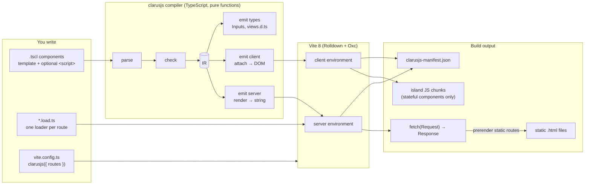
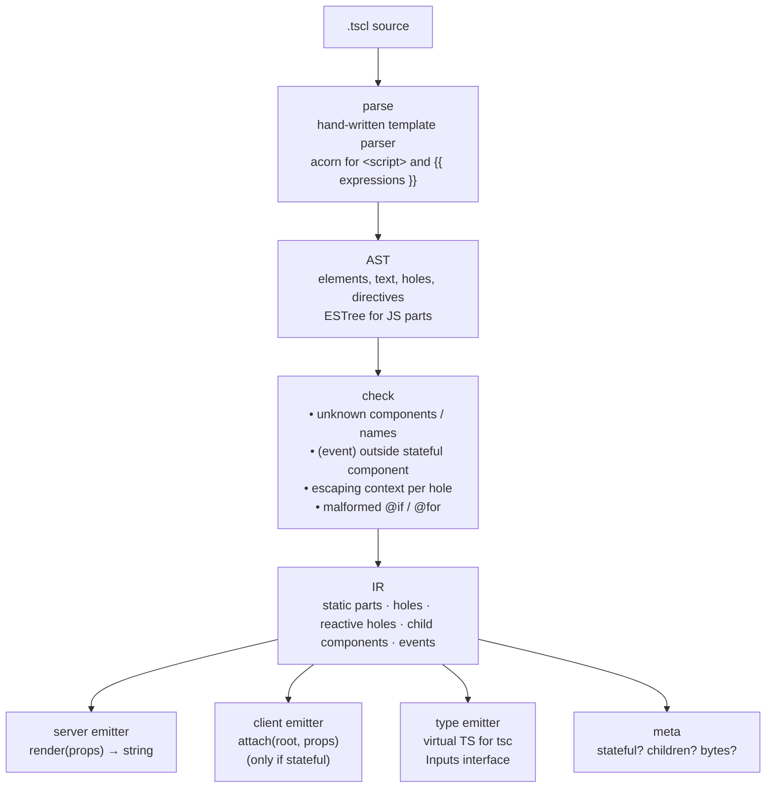
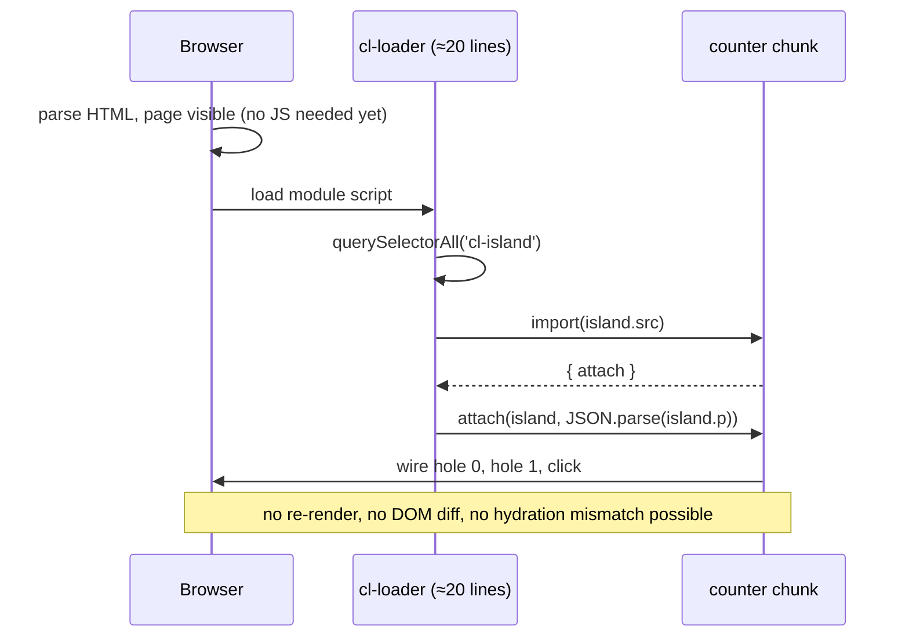
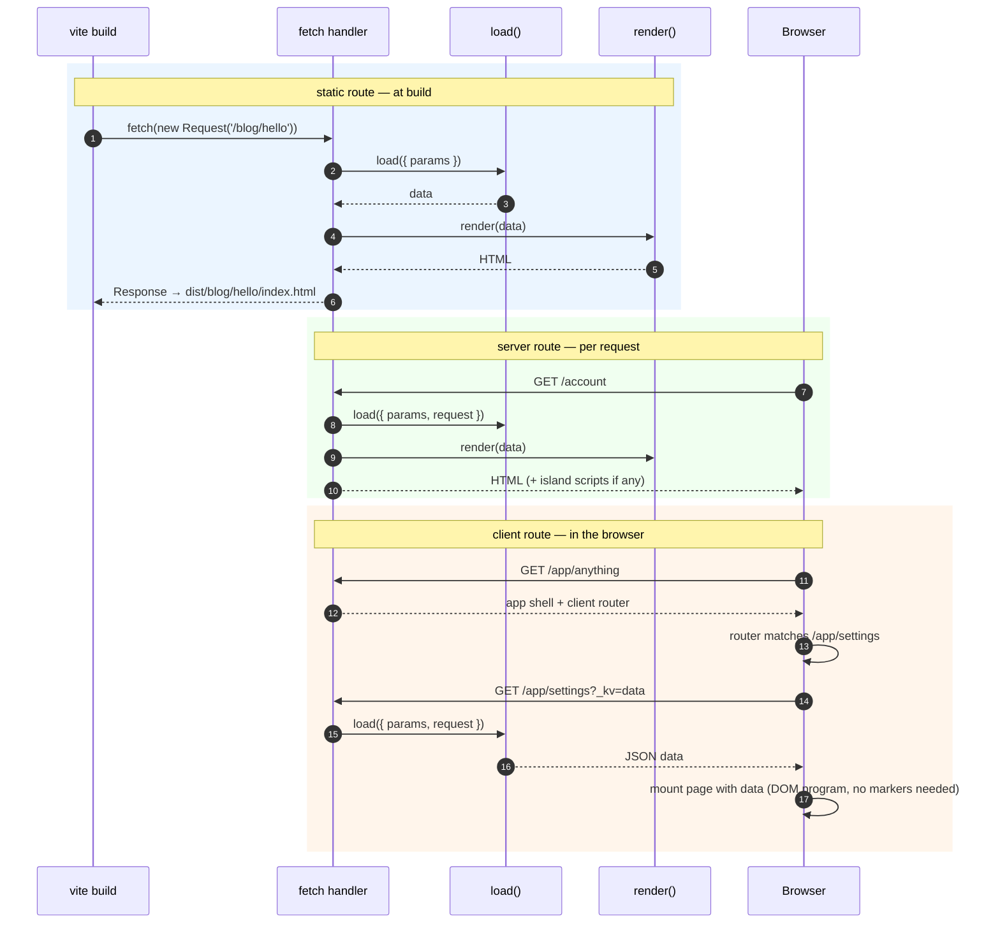
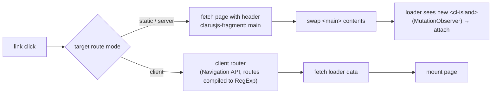
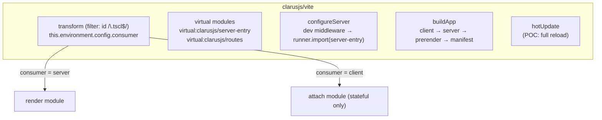
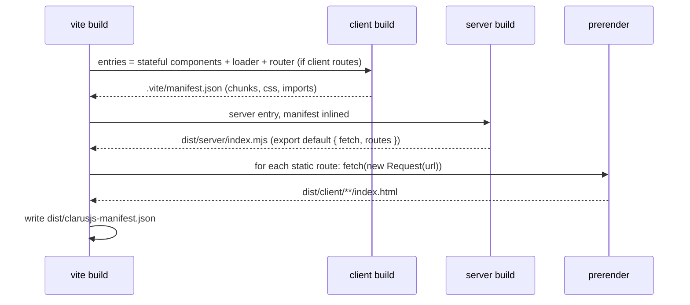
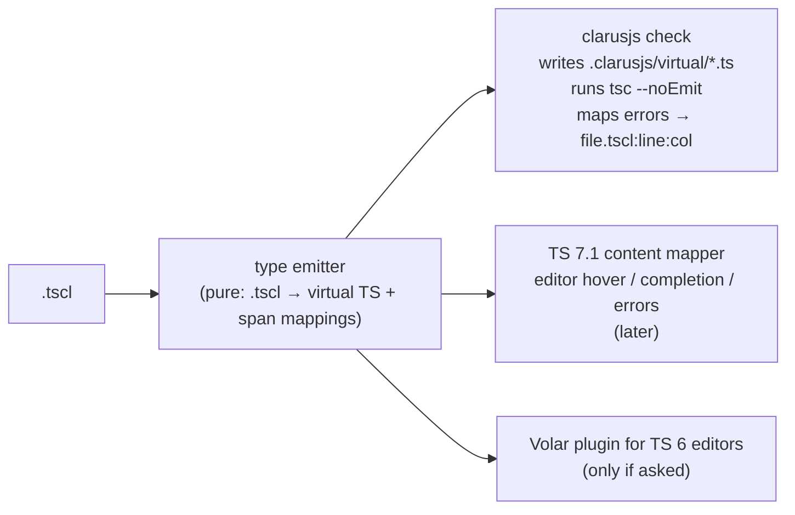

# clarusjs architecture

> How clarusjs turns `.tscl` files into HTML and JS, where every piece runs, and
> how it plugs into Vite, servers, TypeScript and AI agents.
>
> Status: draft for the first proof of concept (POC). Background research
> lives in `.scratch/` (not committed). Items marked **(later)** are designed
> for, not built in the POC.

---

## 1. One sentence

**A `.tscl` file is compiled into a server function that writes HTML, and, only
if it has state, a client function that attaches to that HTML. A route table
says when the server function runs: at build, per request, or in the
browser.**

Everything below expands that sentence.

## 2. Big picture



Three rules make the whole system explainable:

1. **Server code is never in the client module graph.** The client compile
   of a `.tscl` file contains no `render`, no loader, no template strings. This
   is by construction, not by tree shaking.
2. **Only stateful components produce client code.** A component without a
   `<script>` has no client module at all. Zero bytes, always.
3. **One handler produces all HTML.** SSR calls it per request. SSG calls the
   same handler at build time and saves the result. They cannot drift apart.

## 3. Where does my code run?

This table is the heart of clarusjs. `clarusjs explain` prints it for a real route.

| You wrote | `static` route | `server` route | `client` route |
|---|---|---|---|
| Template markup (`<h1>{{ user.name }}</h1>`) | build | each request | browser |
| `*.load.ts` loader | build (once) | each request | server, called by the browser over HTTP |
| `<script>` of a stateful component | build/server (initial values) **and** browser (attach) | server **and** browser | browser |
| `(click)` handlers, `state`, `derived` | browser | browser | browser |
| `@input` types, template checks | compile time only | compile time only | compile time only |

Nothing else runs anywhere. No hidden prefetch, no hidden cache.

## 4. The compiler

Written in TypeScript. A pure `compile(source, options) → { code, map, meta }`
function, called by the Vite plugin and the `clarusjs check` CLI. No file system
access inside the compiler.



### 4.1 Why TypeScript, not Rust or Go

- Vite 8 already does parsing, bundling and minifying in Rust. Compiling
  templates is rarely the slow part. Astro's Go-to-Rust rewrite gained about
  6% on build time.
- Svelte, Vue (including Vapor), Solid, Marko and Angular all compile in JS/TS.
- Passing ASTs between JS and native code is the expensive part, and strings
  are cheap. So the compiler takes a string and returns a string. A Rust port
  (on Oxc) can replace it later without touching anything else **(later, only
  if profiling says so)**.
- Internal JS types are ESTree only, so `oxc-parser` can replace `acorn` with
  no other change.

### 4.2 The IR

The IR is plain data, so it can be dumped for debugging (`clarusjs explain --ir`).

```ts
// shape (simplified)
type ComponentIR = {
  name: string                 // 'counter'
  inputs: Input[]              // from @input
  script?: ScriptIR            // present ⇒ stateful
  nodes: Node[]                // static and dynamic parts, in order
}
type Node =
  | { kind: 'static', html: string }
  | { kind: 'hole', expr: string, context: 'text' | 'attr' | 'url', reactive: boolean, index: number }
  | { kind: 'event', name: 'click', handler: string, index: number }
  | { kind: 'component', name: string, props: Record<string, string>, stateful: boolean }
```

A hole is **reactive** only when its expression reads a `state` or `derived`
of the component's own script. Everything else is rendered once and never
touched again.

### 4.3 What the output looks like

Source:

```kick
{{-- components/counter.tscl --}}
@input start: number = 0

<script>
  let count = state(start)
  const double = derived(() => count * 2)
  function add() { count++ }
</script>

<button (click)="add()">Clicked {{ count }} times (double: {{ double }})</button>
```

Server output (readable, roughly what you'll see in `dist/`):

```js
import { escape as __cl_escape, island as __cl_island } from 'clarusjs/runtime/server'

export function render(__cl_props = {}, __cl_slots, __cl_opts) {
  if (__cl_slots !== undefined) throw new Error("[clarusjs] <counter> does not accept children yet")
  const { start = 0 } = __cl_props
  let count = (start)
  const double = (() => count * 2)()
  function add() { count++ }
  return __cl_island("counter", "/src/components/counter.tscl?import", { start }, "<button data-cl-e=\"0\">Clicked " + "<!--[0-->" + __cl_escape(count) + "<!--]-->" + " times (double: " + "<!--[1-->" + __cl_escape(double) + "<!--]-->" + ")</button>", { count }, __cl_opts?.attach)
}
```

Client output:

```js
import { state, derived, holes as __cl_holes, text as __cl_text, on as __cl_on } from 'clarusjs/runtime'

export function attach(__cl_root, __cl_props = {}, __cl_state) {
  const { start = 0 } = __cl_props
  const count = state(__cl_state && "count" in __cl_state ? __cl_state.count : start)
  const double = derived(() => count.get() * 2)
  function add() { count.set(count.get() + 1) }

  const __cl_h = __cl_holes(__cl_root)                   // finds <!--[n--> markers, once
  __cl_text(__cl_h[0], () => count.get())               // updates only that text node
  __cl_text(__cl_h[1], () => double.get())
  __cl_on(__cl_root, 0, "click", ($event) => { add() }) // delegated, matched by data-cl-e="0"
}
```

`count++` became `count.set(count.get() + 1)`. That rewrite is the only
"magic", and it's visible in the output. Names clarusjs generates start with
`__cl_`, so they never collide with names in your `<script>`.

## 5. The HTML contract

What the server writes, and what the client reads. This is the hardest thing
to change later, so it's fixed now.

```html
<h1>Ada Lovelace</h1>                         <!-- static: no markers, no JS -->

<cl-island c="counter" src="/assets/counter-3f2a.js" p='{"start":3}' s='{"count":3}'>
  <button data-cl-e="0">
    Clicked <!--[0-->3<!--]--> times (double: <!--[1-->6<!--]-->)
  </button>
</cl-island>

<script type="module" src="/assets/cl-loader-9c1e.js"></script>  <!-- only if page has islands -->
```

| Marker | Meaning |
|---|---|
| `<cl-island c src p s a>` | stateful component boundary: name, its JS chunk, its serialized props (`p`), the `state()` values it rendered with (`s`, omitted when it has none) and when to attach (`a`: `idle`, `visible` or `interaction`; omitted for the default, on load). `display: contents`, so it doesn't affect layout |
| `<!--[n-->…<!--]-->` | reactive hole `n`; the client replaces what's between |
| `data-cl-e="n"` | element with event binding `n` |
| `data-cl-a="n"` | element whose attributes read state; the client keeps them in sync |
| `<!--[bn:k-->…<!--]-->` | `@if` block `n` inside an island; `k` is the branch the server rendered (`-1` for none) |
| `<!--[cn-->…<!--]-->` | a child component inside an island whose props or slot content read state; the browser re-renders it, or, when it is a nested island, passes it the new props in place (its inputs are read-only signals; its state is kept) |
| `<!--[fn-->…<!--]-->` | `@for` list `n` inside an island; each row is wrapped in `<!--[r-->…<!--]-->`, `@empty` content in `<!--[e-->…<!--]-->`. Markers inside a row repeat per row and are looked up within that row |

A component with a scoped `<style>` marks its top-level elements with
`data-cl-c="<scope id>"` (from its file path). Its CSS is wrapped in
`@scope ([data-cl-c="<id>"]) to ([data-cl-c]) { … }`, so rules apply inside
the component's elements (the top-level element itself is `:scope`) and stop
at other components. All component styles are bundled into one stylesheet that
every page links. `<style global>` is left as written and marks nothing.

`@import './x.css'` declares a stylesheet a component needs. Each page links
the stylesheets it imports, directly or through its components (dependencies
first), before the component stylesheet. Client-route shells link every client
page's stylesheets, and the router keeps the head across navigations. A
fragment carries its page's links right after its `<title>`; fragment
navigation adds and waits for any that are missing before the swap.

`<cl-head>…</cl-head>`, anywhere in a server-rendered page, holds tags for the
page's `<head>`. The server moves them there before anything else sees the page
(fragments included): a tag with the same key as one already in the head
(`title`, `meta` by `name`/`property`/`charset`/`http-equiv`, the canonical
`link`, `base`) replaces it, others are added. Then the plugin's `head` option
applies: `titleTemplate` wraps the document title unless `<cl-head>` set one,
and site `tags` fill only keys the page left unset. `transformHead(head, page)`
from `src/head.ts` runs last. Pages without their own document get a minimal one
first, so every page goes through the same steps. It is not applied inside
islands or to pages on client routes, which render in the browser: their shell
gets the site tags, and `#cl-routes` carries the template as `data-title` for the
router to apply to each page's title.

Static parts of the page carry **no markers at all** (apart from `data-cl-c` on styled components). Islands are
self-describing, so the loader needs no manifest at runtime and can attach to
islands that arrive later (fragment navigation).

Props are serialized with an XSS-safe serializer. Functions and class
instances as island props are a **compile error**.

### Client routes

A route in `'client'` mode is answered with a shell; the router renders the
page in the browser:

```html
<script type="application/json" id="cl-routes">[{"p":"/tour/[step]","r":"/assets/render/…/_step_-a1b2.js"}]</script>
<script type="module" src="/assets/cl-loader-9c1e.js"></script>
<script type="module" src="/assets/cl-router-4d5e.js"></script>
```

| Part | Meaning |
|---|---|
| `#cl-routes` | the client routes in matching order: `p` is the route as its file names it (`[param]` segments), `r` the URL of the page's browser render module (`render(props)`). `<` is escaped, so the JSON can't close the script |
| `<path>/__data.json` | the page's props (params plus `load()`), in the island serializer's format. Written next to the shell at build; served by the handler in dev and on a server |

The router swaps `<head>` and `<body>` for the rendered page and calls the
loader's attach hook, so islands on a client page work as anywhere else.

### Fragments

With `fragments: true`, every static and server page also answers at
`<path>/index.frag.html` (a file next to `index.html` for static pages; the
handler for server routes): the page's `<title>` followed by its swap region,
the element marked `data-cl-swap`, or its `<body>` when nothing is marked.
Fragment navigation replaces only that region. The URL, not a request header,
selects a fragment, so it works on static hosts and caches like any file.

| Part | Meaning |
|---|---|
| `data-cl-swap` | the region a fragment replaces (one per page); without it, the body |
| `<path>/index.frag.html` | `<title>…</title>` + the swap region's HTML |
| `data-cl-persist="key"` | an element kept across swaps: the one already on the page moves into the new region, in place of the new page's element with the same key |

Each static and server page loads the navigation script (`cl-nav`), which
brings the island loader. It intercepts same-site navigations with the
Navigation API, swaps the fragment in and calls the loader's attach hook.

## 6. The runtime

Target under 5 KB total; the POC aims at about 1–2 KB.

| Module | Job | Runs |
|---|---|---|
| `clarusjs/runtime/server` | `escape`, `escapeAttr`, `island()` | server/build |
| `clarusjs/runtime` signals | `state`, `derived`, `effect` (push-pull, alien-signals-style) | browser |
| `clarusjs/runtime` DOM | `holes`, `text`, `attr`, `on` (one delegated listener per event type) | browser |
| `clarusjs/runtime/loader` | find `<cl-island>`, `import(src)`, call `attach` | browser |



**State from the server.** The `s` attribute carries the `state()` values the island rendered with. `attach` starts
from them, so an initial value like `Date.now()` isn't recomputed in the browser; `derived()` values are recomputed
from the restored state. Values go through `runtime/serialize.ts` (JSON plus Date, Map, Set, undefined, NaN, ±Infinity,
-0, BigInt; functions, class instances and cycles are rejected with their path). Other locals in `<script>` still run
again in the browser. **Island props and state are public**: they are in the page. Reading server-only globals
(`process`, `Deno`, `Bun`, `require`) in an island's script is a build error.

## 7. Data flow

### 7.1 Routes and modes

```ts
// vite.config.ts
import { defineConfig } from 'vite'
import clarusjs from 'clarusjs/vite'

export default defineConfig({
  plugins: [clarusjs({
    routes: {
      '/blog/*':    'static',   // HTML at build time
      '/account/*': 'server',   // HTML per request
      '/app/*':     'client',   // HTML in the browser
    },
  })],
})
```

Pages are files: `src/pages/users/[id].tscl`. The route's loader, if any, is
the sibling `src/pages/users/[id].load.ts`. A separate file makes "this runs
outside the template" visible from the file tree.

```ts
// src/pages/users/[id].load.ts
import type { Load } from 'clarusjs'
export const load: Load<'users/[id]'> = async ({ params, request }) => {
  return { user: await db.users.find(params.id) }   // must match the page's @input
}
```

The return type is checked against the page's `@input` block. Mismatch =
build error.

### 7.2 One loader, three timings



The page component never knows which of the three happened. It only sees
its typed `@input`s.

**Mode guard:** a loader always runs on a server or at build, even for
`client` routes (the browser calls it over HTTP). So secrets in loaders are
safe in every mode, and clarusjs never needs a "server-only" annotation.

## 8. State

| Kind | How | Lives |
|---|---|---|
| Component state | `state()`, `derived()` in `<script>` | one island instance |
| Shared client state | a `.ts` module exporting `state()` values, imported by islands | the browser tab |
| Request data | loader return → `@input` | one request (server) |
| Server-to-client hand-off | island props, serialized into `p` | the HTML |

Shared state is plain module state, no store library:

```ts
// src/stores/cart.ts
import { state } from 'clarusjs'
export const cart = state<Item[]>([])
```

Rule enforced by the compiler: **module state can't be read while rendering
on the server**, because it would leak between requests. Islands may read it
only in the browser. Server-side per-request values flow only through loaders
and props.

## 9. Navigation and routing



- `static` and `server` routes: no client router. The server returns just the
  fragment when it sees the `clarusjs-fragment` header (`Vary` set). Static
  routes get a prebuilt `index.frag.html` beside `index.html` **(later)**.
- Islands re-attach on their own after a swap. You never write an `onLoad`
  hook. Mark an element `cl-persist` to keep it across swaps **(later)**.
- `client` routes: a router (at most 1.45 KB gzip) ships only for them.

## 10. Vite integration

One plugin. It's a thin adapter around the compiler.



| Hook | What clarusjs does |
|---|---|
| `transform` | Compile `.tscl`. Server environment gets `render`, client environment gets `attach`. Hook filter means Rolldown never calls into JS for other files |
| `resolveId`/`load` | Virtual modules: the server entry (route table + handler) and the route list |
| `configureServer` | Dev: turn the Node request into a `Request`, call the handler loaded via `runner.import()`, so server code gets HMR |
| `buildApp` | Build client (with `build.manifest`), build server, call the handler for every `static` route, write `clarusjs-manifest.json` |
| `hotUpdate` | POC: full reload. **(later)** swap the island in place |

Targets Vite 8 (Rolldown). Minimum Vite 6.3 (hook filters). Files are
emitted with `this.emitFile`, never by mutating the bundle.

### 10.1 Build sequence



### 10.2 Route manifest

Plain JSON, one entry per route. This is what `clarusjs explain` reads.

```json
{
  "/users/[id]": {
    "mode": "server",
    "loader": { "file": "src/pages/users/[id].load.ts", "runs": "per request" },
    "islands": [{ "name": "counter", "chunk": "assets/counter-3f2a.js", "bytes": 612 }],
    "js": { "total": 1840, "files": ["assets/cl-loader-9c1e.js", "assets/counter-3f2a.js"] },
    "css": ["assets/users-1b2c.css"]
  }
}
```

## 11. Server integration

The server build exports one standard handler:

```ts
// dist/server/index.mjs
export default { fetch(request: Request): Promise<Response> }
```

That shape runs unchanged on Bun, Deno and Cloudflare Workers, and on Node
through a tiny adapter (`srvx`, Hono, or ~20 lines). Any existing backend can
mount it:

```ts
// Node, no framework
import { serve } from 'srvx'
import app from './dist/server/index.mjs'
serve({ fetch: app.fetch, port: 3000 })
```

```ts
// inside an existing Hono / Express-like app: mount on a path
app.all('/app/*', (c) => kv.fetch(c.req.raw))
```

Static-only sites need no server at all: deploy `dist/client/`.

## 12. TypeScript support

One code generator, three hosts.



Template → virtual TS, Angular-style:

| Template | Virtual TS |
|---|---|
| `@input user: User` | `export interface Inputs { user: User }` |
| `{{ user.name }}` | `'' + (user.name);` |
| `@if (user.admin) { … }` | `if (user.admin) { … }` (narrowing works) |
| `@for (u of users) { … }` | `for (const u of users) { … }` |
| `<badge [label]="x" />` | `__cl_component(Badge, { label: x });` |
| `(click)="add()"` | `($event: MouseEvent) => { add() };` |
| `let count = state(0)` | `let count = state(0)` with `state<T>(v: T): T` |

Typed `render('users/show', data)` and `Load<'users/[id]'>` come from a
generated `.clarusjs/views.d.ts` that adds each view to a `ViewRegistry`
interface. Errors TypeScript can't see (unknown component, `(click)` in a
stateless component) come from the compiler, in the same `file:line:col`
format.

## 13. AI agents and humans reading the same things

clarusjs is explainable by producing artifacts, not by special AI features:

| Artifact | Who reads it |
|---|---|
| Readable compiled output in `dist/` | anyone debugging |
| `clarusjs-manifest.json` | tools, CI budgets, agents |
| `clarusjs explain <route> [--json]` | humans (text), agents (JSON) |
| `clarusjs check [--json]` | humans, CI, agents (tsc-style lines) |
| `docs/architecture.md` (this file) | anyone new |
| `llms.txt`, MCP server over `check`/`explain` | agents **(later)** |

Example:

```
$ clarusjs explain /users/42
/users/[id]  mode: server
  loader     src/pages/users/[id].load.ts — runs per request on the server
  render     src/pages/users/[id].tscl     — runs per request on the server
  islands    counter (612 B) — attaches in the browser at load
  static     h1, layout — HTML only, 0 B JS
  total JS   1.8 KB (loader 0.4 KB + counter 0.6 KB + runtime 0.8 KB)
```

## 14. Package layout

A pnpm workspace, versioned and published with changesets. One framework package to start, with subpath exports;
it splits into `@clarusjs/*` packages (compiler, runtime, vite) by moving folders under `packages/` once there's a reason.

```
packages/
  clarusjs/
    src/
      compiler/   parse.ts ir.ts script.ts emit-server.ts emit-client.ts shared.ts
      runtime/    signals.ts dom.ts loader.ts server.ts
      server/     handler.ts
      vite/       plugin.ts node.ts
    test/
examples/
  counter/        private app, depends on clarusjs: workspace:*
.changeset/
```

| Export | Contents |
|---|---|
| `clarusjs/compiler` | `compile()` |
| `clarusjs/runtime` | signals + DOM attach (browser) |
| `clarusjs/runtime/server` | escape, island |
| `clarusjs/server` | `createHandler()` |
| `clarusjs/vite` | the plugin |

Runtime dependencies: `acorn` (compiler only); `vite` is a peer dependency. Nothing ships to the browser
except clarusjs's own runtime. In the repo, `exports` point at `src/*.ts`; the published package is the compiled
`dist/` (JS + `.d.ts`), swapped in from `publishConfig.exports` when packing. Releases: see RELEASE.md.

## 15. Decisions so far

| Decision | Choice | Alternatives considered |
|---|---|---|
| Compiler language | TypeScript, string in / string out, ESTree types | Rust on Oxc (later, only if profiled); Go (no TS 7 API, Astro left it) |
| Compile strategy | Two emitters (server string, client attach) from one IR | Ship IR as JSON + shared interpreter: bigger runtime, compiler does less |
| JS parser | `acorn` | `oxc-parser`: slower than acorn without experimental raw transfer; Vite's `this.parse` ties compiler to Vite |
| Hydration | Attach to markers, never re-render | Full hydration (mismatch bugs), resumability (Qwik's `$` mental model) |
| Mode selection | Explicit glob table | Inferred from code (Next.js): can't be read or explained |
| Navigation | Server fragments + auto re-attach; client router only for `client` routes | Global SPA router |
| Type checking | Virtual TS + `tsc` via CLI first | Full language server first |

## 16. POC scope

Proves: one page rendered on the server, static `<h1>`, one `<counter>`
interactive in the browser, the counter's chunk + loader as the only JS.

In: parser (elements, text, `{{ }}`, `@input`, `<script>`, `(click)`,
`[prop]`), signal rewrite (`state`, `derived`, `++`, `=`, `+=`), both
emitters, runtime, Vite plugin (dev SSR via `runner.import`), fetch handler,
one test asserting the page's scripts are exactly loader + counter.

Out (designed for, later): `@if`/`@for`, slots, layouts, `clarusjs check`,
modes/loaders/SSG, manifest, `explain`, fragments, router, HMR beyond full
reload, content mapper, MCP.

## 17. Later stages

1. `@if`/`@for` with block markers, nested islands, state serialization, `clarusjs check` + `views.d.ts`.
2. Route modes, loaders with type contracts, `buildApp` prerender, `clarusjs-manifest.json`, `clarusjs explain`.
3. Fragment navigation, auto re-attach, `cl-persist`, client router, lazy attach with event replay.
4. TS 7.1 content mapper (editor support), `llms.txt`, MCP server.
5. Only if profiling demands: `oxc-parser` or a Rust compiler core.

## 18. Open questions

1. Lazy attach triggers (`idle`, `visible`, `interaction`): opt-in attribute on
   the component tag, or a default? (Stage 3.)
2. Do client-mode pages reuse the server-emitted render path for the shell,
   or always mount fresh? (Stage 2–3.)
3. Layout syntax: `@layout('…')` from `.kick`, or nested layout files per
   directory? (Stage 2.)
